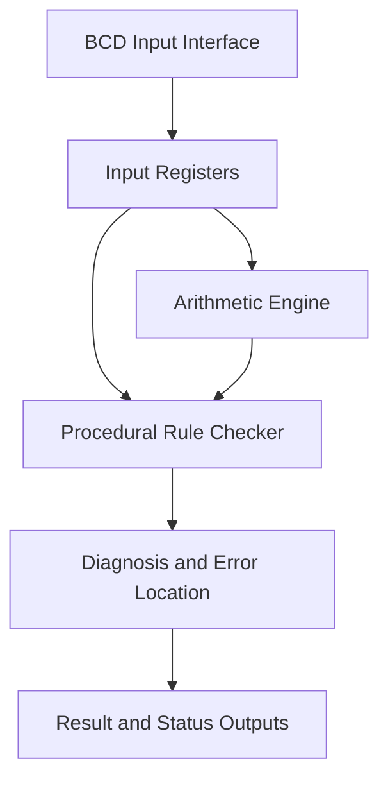
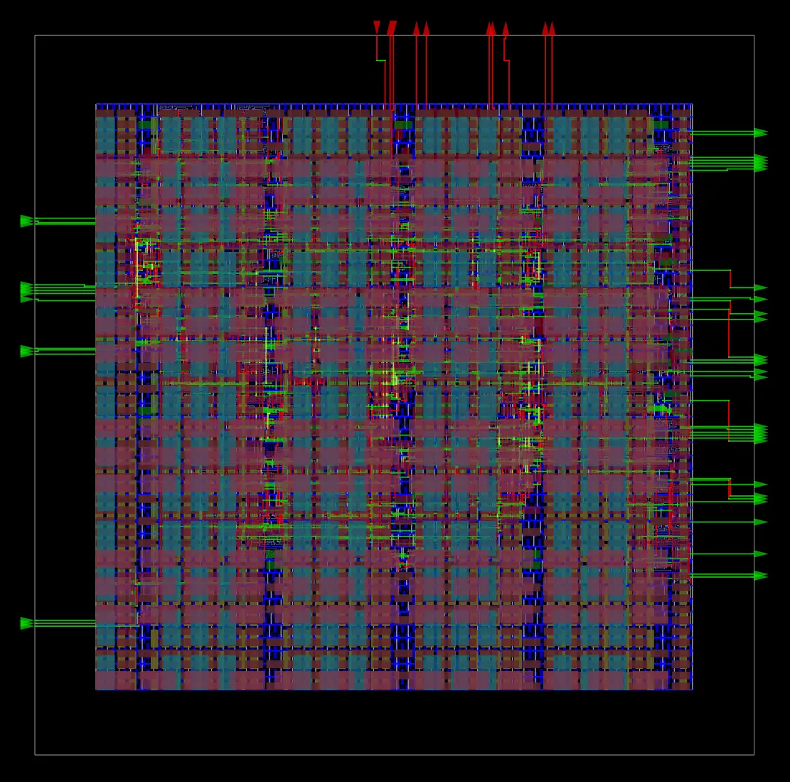
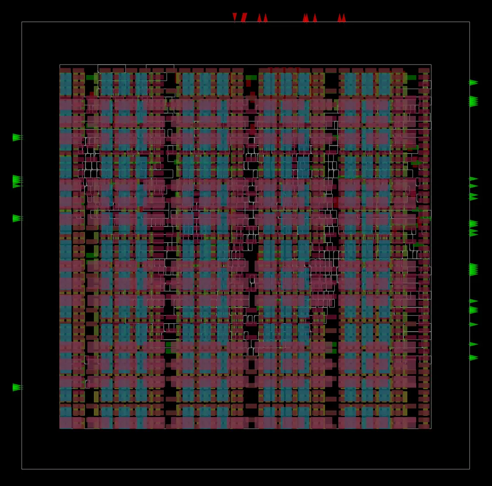
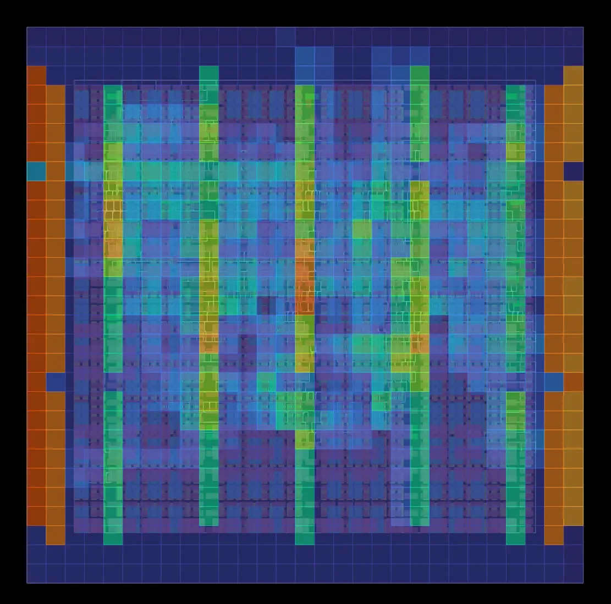
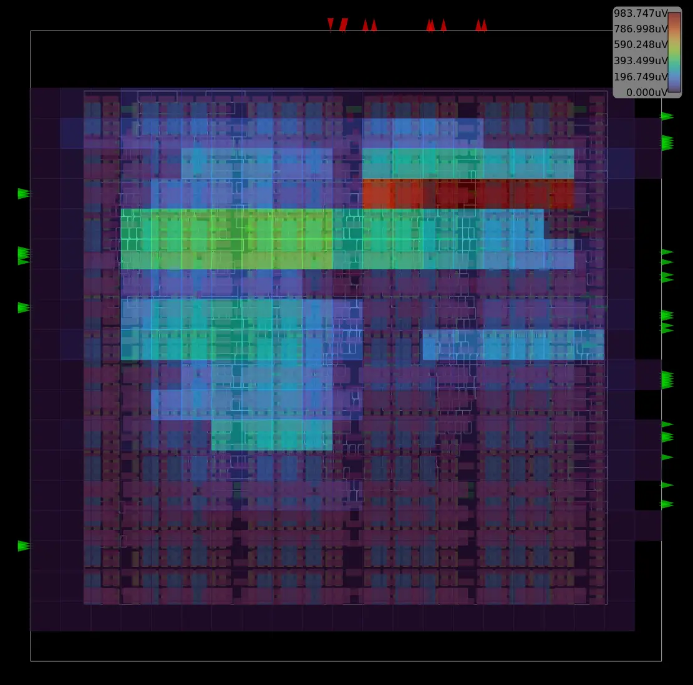
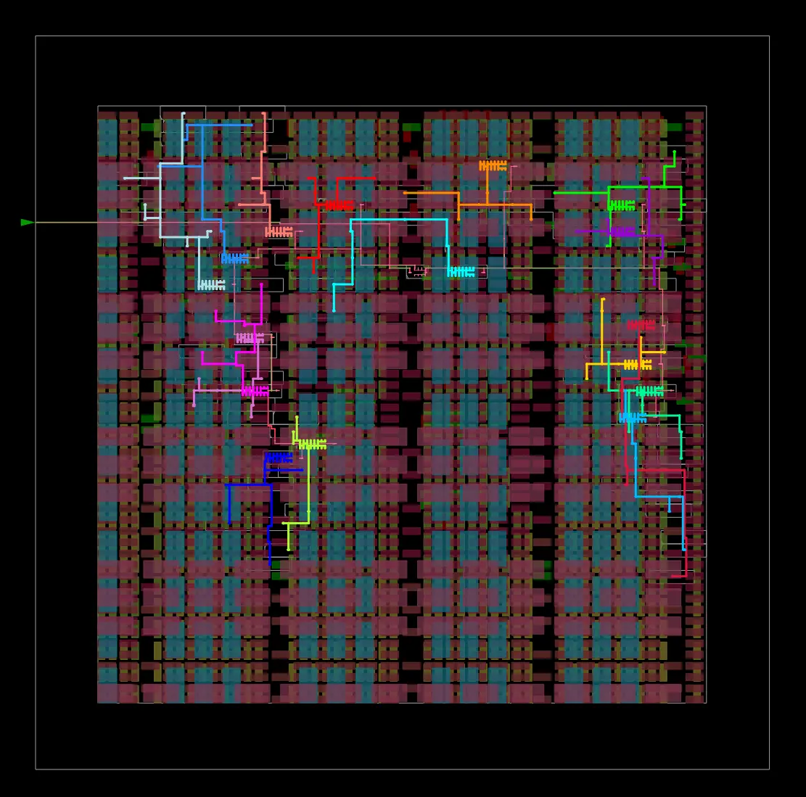

# Hardware Multi-Digit Arithmetic Error Diagnosis Engine

RTL-to-GDSII implementation of a hardware engine that analyzes multi-digit arithmetic work, calculates the correct result, locates errors, and identifies the likely procedural bug.

This project follows the **UNPS26 Hands-On Project guideline** and its required `ump26s_<name>` directory structure.

## Project Information

- **Designer:** Ahmed Lutfe Inam
- **University:** Islamic University of Technology (IUT)
- **Technology:** IHP SG13G2 130 nm
- **Flow:** OpenROAD Flow Scripts
- **RTL:** Verilog
- **Top module:** `top`
- **Target frequency:** 50 MHz
- **Clock period:** 20 ns

## Project Objective

The objective is to implement a synthesizable hardware engine that examines multi-digit arithmetic work, calculates the correct result, locates an error, and classifies the likely procedural mistake. The complete design is taken from verified Verilog RTL through physical implementation in IHP SG13G2.

## Problem Statement

Students can produce an incorrect arithmetic answer through different procedural mistakes, including omitted carries, incorrect digit operations, missing partial products, or incorrect alignment. A final-answer comparator cannot explain the cause. This hardware module analyzes the submitted work and returns both the corrected result and a diagnostic bug code.

## Application Domain

**Education and Learning Technologies** - especially digital tutoring, automated assessment, and arithmetic-learning hardware accelerators.

## Project Overview

BCD digits, field identifiers, and digit positions are loaded into the engine. After submission, the control logic reconstructs the entered arithmetic work, computes the expected result, compares intermediate values, and generates the bug ID, error location, confidence, corrected result, and mismatch score.

## Block Diagram



## Design Specifications

| Specification | Value |
|---|---|
| Technology | IHP SG13G2 130 nm |
| Language | Verilog HDL |
| Physical-design flow | OpenROAD |
| Clock frequency | 50 MHz |
| Clock period | 20 ns |
| Input width | 16 bits |
| Output width | 38 bits |
| Top module | `top` |

## Functionality

- Multi-digit addition and multiplication diagnosis
- BCD digit input and validation
- Correct-result calculation
- Error row and column identification
- Bug-rule classification
- Confidence and mismatch-score outputs

## Bug Identification Codes

| ID | Diagnosis |
|---:|---|
| 0 | No error |
| 1 | Carry not generated |
| 2 | Carry not added |
| 3 | Carry in wrong column |
| 4 | Multiplication fact error |
| 5 | Multiplication carry omitted |
| 6 | Missing partial-product shift |
| 7 | Partial-product row omitted |
| 8 | Final addition error |
| 14 | Invalid BCD |
| 15 | Unknown or ambiguous error |

## Repository Structure

```text
ump26s_inam/
├── README.md
├── .gitignore
├── inputs/
│   ├── rtl/
│   │   ├── top.v
│   │   └── arithmetic_diagnosis_engine.v
│   ├── sdc/constraints.sdc
│   └── config.mk
├── outputs/
│   ├── netlist/final.v
│   ├── netlist/final.sdc
│   └── gds/final.gds
├── simulation/
│   ├── tb_arithmetic_diagnosis_engine.v
│   ├── run_simulation.sh
│   └── simulation.log
└── docs/
    ├── project_proposal.pdf
    ├── screenshots/
    └── reports/
```

The final report will be added later according to the instructor's separate report guidance.

## RTL Verification

A self-checking Icarus Verilog testbench covers correct and erroneous addition and multiplication cases.

- **Passed:** 12
- **Failed:** 0
- **Result:** ALL TESTS PASSED

Run it with:

```bash
./simulation/run_simulation.sh
```

## Timing Constraints

- Clock period: 20 ns
- Input and output delay: 2 ns
- Clock uncertainty: 0.2 ns
- Clock transition: 0.1 ns
- Asynchronous reset excluded with a false-path constraint

## RTL-to-GDSII Stages

1. RTL simulation
2. Logic synthesis and IHP standard-cell mapping
3. Floorplanning, I/O placement, and PDN generation
4. Global and detailed placement
5. Clock-tree synthesis
6. Global and detailed routing
7. Filler-cell and metal-fill insertion
8. Parasitic extraction
9. Timing, power, IR-drop, DRC, and antenna verification
10. Final netlist, SDC, and GDS generation

## Final Results

| Metric | Result |
|---|---:|
| Synthesized cells | 653 |
| Die size | 208.965 µm × 208.965 µm |
| Core size | 173.280 µm × 170.100 µm |
| Final design area | 9,976 µm² |
| Core utilization | 34% |
| Clock buffers | 17 |
| Setup WNS / TNS | +16.29 ns / 0.00 ns |
| Hold WNS / TNS | +0.07 ns / 0.00 ns |
| Estimated power | 0.408 mW |
| Detailed-routing DRC violations | 0 |
| Antenna violations | 0 |
| VDD/VSS worst IR drop | 1.13 mV / 0.984 mV |

Positive setup and hold slack confirm operation at the target 50 MHz frequency. Placement is legal, detailed-routing DRC and antenna checks pass, both power networks are fully connected, and parasitic extraction and GDS merge completed successfully.

One clock-root fanout finding is documented: `clkbuf_0_clk/X` drives 16 clock branches against a reported limit of 8. Setup, hold, maximum-slew, and maximum-capacitance checks pass.

## Layout Results

### Final Routed Layout



### Placement Density



### Routing Congestion



### IR Drop



### Clock Tree



## Reproducing the Flow

```bash
cd ~/eda/OpenROAD-flow-scripts
source env.sh
cd flow
make DESIGN_CONFIG=/home/inam/projects/ump26s_inam/inputs/config.mk
make finish DESIGN_CONFIG=/home/inam/projects/ump26s_inam/inputs/config.mk
```

## Deliverables

- RTL: `inputs/rtl/`
- Constraints and configuration: `inputs/sdc/constraints.sdc`, `inputs/config.mk`
- Final netlist and SDC: `outputs/netlist/`
- Final GDSII: `outputs/gds/final.gds`
- Proposal: `docs/project_proposal.pdf`
- Verification evidence: `docs/reports/`
